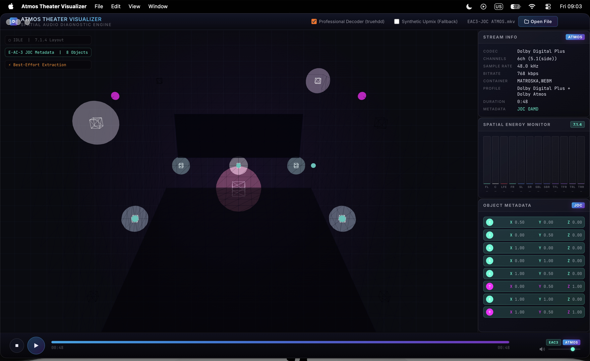
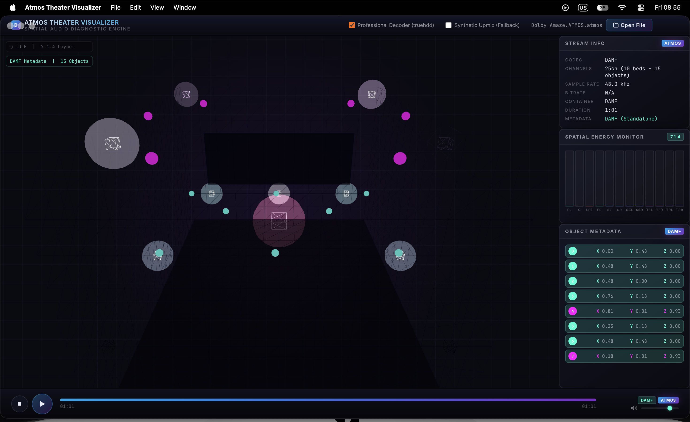
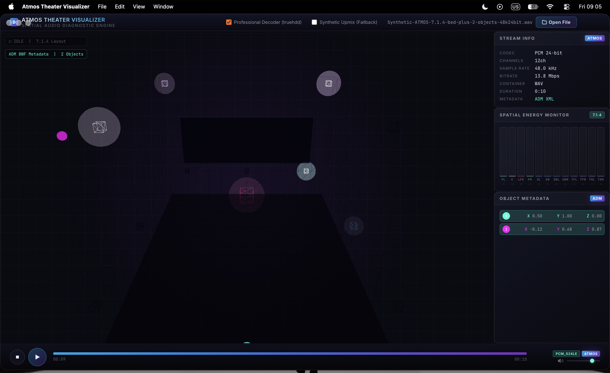

# Atmos Theater Visualizer 🎬


[](https://github.com/Hirushikanth/Theater-Simulator/releases/latest)

**Atmos Theater Visualizer** is a professional-grade, Electron-based desktop application for real-time decoding, parsing, and 3D spatial visualization of Dolby Atmos audio across all major formats — including native TrueHD DAMF, ADM BWF, and E-AC-3 JOC streams.

> [!IMPORTANT]
> **LEGAL NOTICE & USAGE:** This is an **unofficial** Dolby Atmos object viewer developed strictly for **educational and individual use**. It is not affiliated with, endorsed by, or licensed by Dolby Laboratories.

---

## 📸 Screenshots

E-AC-3 JOC object tracking (8 live objects, per-object positions):



Standalone DAMF master (10 beds + 15 objects, binary CAF fold-down audio):



ADM Broadcast Wave (12-channel master, 2 animated objects):



---

## ✨ Key Features

- **Real-Time 3D Theater Visualization:** A stunning Three.js-powered home theater with dynamic object spheres and per-speaker glow indicators — updated at the display refresh rate (60 FPS+).
- **Professional TrueHD Atmos Decoding:** Full end-to-end pipeline using the Rust-based **[truehdd](https://github.com/truehdd/truehdd)** decoder:
  - Auto-detects and extracts raw `.thd` bitstreams from MKV/MKA containers via FFmpeg
  - Decodes to **DAMF** (Dolby Atmos Master Format): `.atmos` root + `.atmos.metadata` events
  - Parses all object trajectories with frame-accurate binary-search interpolation
  - FFmpeg provides the 7.1 playback audio from the original container
- **Native ADM BWF Support (up to 118+ channels):**
  - Efficiently reads **only** the `axml` RIFF chunk for XML metadata (avoids loading multi-GB audio into RAM)
  - Proper ADM reference chain resolution: `audioObject → audioPackFormat → audioChannelFormat → audioBlockFormat`
  - **Direct binary WAV/BW64 channel extraction** (no FFmpeg): overcomes the FFmpeg `pan` filter 64-channel hard limit for high-channel-count master files
  - Supports **RIFF** (≤4 GB) and **RF64/BW64** (>4 GB) formats, 16/24/32-bit PCM
- **Native E-AC-3 JOC Parser:** Custom bit-level protocol decoder for Dolby Digital Plus Atmos streams. Extracts OAMD spatial keyframes natively from `.eac3`, `.mp4`, `.mkv`.
- **DAMF Standalone Support:** Opens `.atmos` root files with companion `.atmos.metadata` — visualizes up to 80+ dynamic object trajectories and plays the companion `.atmos.audio` (CAF) through a built-in binary fold-down mixer.
- **Selectable Speaker Layouts:** 5.1, 5.1.2, 5.1.4, 7.1, 7.1.2, 7.1.4, 7.1.6, 9.1.6, plus 5.2/7.2/9.2 dual-subwoofer variants. The 3D room, panning targets, and meters rebuild instantly without interrupting playback.
- **Advanced Spatial Panning (VBAP):** Vector Base Amplitude Panning with automatic convex-hull triangulation for every layout, plus an angular-blend fallback for sparse layouts such as 5.1.2.
- **Layout-Aware VU Metering:** Real-time high-resolution level metering for every speaker in the selected layout, including dual subwoofers.
- **Synthetic Upmix Fallback:** Audio-reactive virtual objects for files where proprietary metadata is inaccessible (optional, can be disabled).
- **Premium Glassmorphic UI:** Professional dashboard with dark-mode design, real-time object metadata panel, and stream info sidebar.

---

## 📂 Supported Formats

| Format | Metadata Source | Audio |
|---|---|---|
| TrueHD / MKV, MKA, raw `.thd`/`.truehd`/`.mlp` | DAMF (truehdd decoded) | FFmpeg 7.1 from container (or the raw bitstream) |
| E-AC-3 JOC / MP4, MKV, .eac3 | Native JOC OAMD parser | FFmpeg decode |
| ADM BWF / .wav (≤118ch, BW64) | ADM XML (axml chunk) | Binary WAV extractor |
| Standalone `.atmos` | DAMF (direct file) | Binary CAF fold-down (stereo WAV) |
| PCM / WAV, FLAC, MP3, AAC/M4A, Ogg/Opus | None | FFmpeg decode |

---

## 🛠️ Getting Started

### Download (recommended)

Grab the latest `Atmos Theater Visualizer-*-arm64.dmg` (or `.zip`) from
[GitHub Releases](https://github.com/Hirushikanth/Theater-Simulator/releases/latest),
drag the app to **Applications**, and launch it. FFmpeg/ffprobe and truehdd are
bundled — no setup needed.

> **First launch:** the build is Developer-ID signed but not notarized, so macOS
> may block it. Right-click the app → **Open** → **Open** once; afterwards it
> launches normally.

### Build from source

### Prerequisites
- [Node.js](https://nodejs.org/) (>=22.12 <25 — 24 LTS recommended, matching `engines` in `package.json`; required by Electron 44 and electron-builder 26)
- [npm](https://www.npmjs.com/) (on Windows, use `npm.cmd` if PowerShell blocks `npm.ps1` via ExecutionPolicy)
- [Rust & Cargo](https://rustup.rs/) — only required if building the Professional TrueHD Decoder from source (Option B below). On Windows a source build also needs Visual Studio Build Tools with the "Desktop development with C++" workload (provides `link.exe`/`cl.exe`). The prebuilt binary path (Option A) needs no Rust.

### Installation & Setup

1. **Clone the repository:**
   ```bash
   git clone https://github.com/Hirushikanth/Theater-Simulator.git
   cd Theater-Simulator
   ```

2. **Install Node dependencies:**
   ```bash
   npm install
   ```

  3. **Install the Professional TrueHD Decoder (Recommended, requires truehdd 0.4.0+ — tested with 0.4.0 and 0.6.2):**

    The application uses `truehdd` for native TrueHD Atmos DAMF extraction. Without it, TrueHD files will show a MAT-Encrypted fallback (no object visualization).

    **Option A — Prebuilt binary (recommended, no Rust needed):**

    Download the release for your OS from the [truehdd releases page](https://github.com/truehdd/truehdd/releases) (tested with `0.4.0` and `0.6.2`; on Windows pick the `*-x86_64-pc-windows-msvc.zip` asset containing `truehdd.exe`), then place it in the project's `bin/` folder:

    ```bash
    # macOS / Linux
    unzip truehdd-*.zip
    mkdir -p Theater-Simulator/bin
    cp truehdd Theater-Simulator/bin/
    ```

    ```powershell
    # Windows (PowerShell) — note the .exe name
    Expand-Archive truehdd-*-x86_64-pc-windows-msvc.zip -DestinationPath truehdd-dl
    New-Item -ItemType Directory -Force -Path Theater-Simulator\bin | Out-Null
    Copy-Item truehdd-dl\truehdd.exe Theater-Simulator\bin\
    ```

    **Option B — Build from source (requires Rust + Cargo):**

    ```bash
    # Clone truehdd
    git clone https://github.com/truehdd/truehdd
    cd truehdd

    # Build the release binary
    cargo build --release

    # Copy binary to the project's bin folder
    mkdir -p ../Theater-Simulator/bin
    cp target/release/truehdd ../Theater-Simulator/bin/
    ```

    ```powershell
    # Windows (PowerShell) — same build, Windows copy (requires VS Build Tools C++ workload)
    cargo build --release
    New-Item -ItemType Directory -Force -Path ..\Theater-Simulator\bin | Out-Null
    Copy-Item target\release\truehdd.exe ..\Theater-Simulator\bin\
    ```

    **Verify (all platforms):**

    ```bash
    ./Theater-Simulator/bin/truehdd --version   # macOS / Linux
    .\Theater-Simulator\bin\truehdd.exe --version  # Windows (expect 0.4.0+)
    ```

    > **Note (Windows):** the app resolves `bin/truehdd.exe` (platform-aware lookup), so a correctly installed binary in `bin\` is found automatically.

4. **Run in Development Mode:**
   ```bash
   npm run dev
   ```

5. **Build for Production:**
   ```bash
   npm run build
   ```

6. **Package Installers (DMG/EXE/AppImage):**
   ```bash
   npm run dist
   ```

---

## 🖱️ How to Use

1. **Launch the App** (installed build or `npm run dev`)
2. **Enable Professional Decoder** in the top bar (requires `bin/truehdd` on macOS/Linux, `bin/truehdd.exe` on Windows)
3. **Load audio** — any of these:
   - **Click Open File** — supported formats are listed above
   - **Drag & drop** a file onto the window
   - **Double-click** a media file / right-click → **Open With** (file associations are registered by the installer)
4. **Watch the terminal** for real-time decode progress (truehdd frame count, wav-extract stats, etc.)
5. **Hit Play** (or press `Space`) and watch the Atmos objects move through the 3D theater in sync with the audio

> **Tip:** Objects activate a few seconds into TrueHD content — this reflects the real DAMF event timeline where objects start inactive and transition to active positions.

---

## 🏗️ Architecture

```
File Opened
├── .atmos  → loadAtmosStandalone()
│               ├── DAMFParser (root + .atmos.metadata) → object trajectories
│               └── extractCafAudio → binary CAF fold-down → stereo WAV (playback)
│
└── Other   → analyzeFile (ffprobe)
              ├── TrueHD + Professional Decoder
              │     ├── FFmpeg extracts raw .thd from container
              │     ├── truehdd decodes → DAMF files
              │     ├── DAMFParser → object trajectories
              │     └── FFmpeg decodes original container → 7.1 WAV (playback)
              │
              ├── E-AC-3 / AC-3
              │     ├── FFmpeg → PCM WAV (playback)
              │     └── JOC OAMD parser → object positions
              │
              └── WAV (ADM BWF)
                    ├── readAXMLChunk → ADM XML parser → object positions
                    └── extractWavChannels → first 8ch binary extract → playback
```

**Key design decisions:**
- **Audio and metadata are decoupled** for TrueHD: truehdd handles metadata, FFmpeg handles audio. This avoids complex multi-channel CAF rematrix issues.
- **ADM audio bypasses FFmpeg entirely**: the bundled `wav-extract.js` copies PCM frames at the binary level — no channel limit, no codec conversion, no quality loss for the first 8 channels.
- **axml-only parsing** for ADM: only the XML chunk is read from disk, not the GB-scale audio data.
- **Metadata updates run at the display refresh rate:** the Three.js scene is driven directly from the rAF loop (no React re-renders), while React state updates for the playhead, objects, and speaker gains follow every animation frame — 60 FPS on a 60 Hz display, matching higher refresh rates on capable panels. Identity-guarded object updates prevent redundant re-renders between keyframes.

---

## 🔊 Metadata Sources

| Source Label | Description |
|---|---|
| `JOC OAMD` | Native E-AC-3 JOC bit-level parse — highest fidelity for streaming Atmos |
| `DAMF (TrueHD Decoded)` | truehdd-decoded `.atmos.metadata` — frame-accurate object events |
| `DAMF (Standalone)` | Direct `.atmos` file — full DAMF trajectory visualization + CAF audio fold-down |
| `ADM XML` | ITU-R BS.2076 ADM XML — professional mastering source positions |
| `TrueHD MAT (Parse Fallback)` | truehdd unavailable or incompatible binary |
| `E-AC-3 (Parse Fallback)` | Encrypted/proprietary JOC payload |
| `SYNTHETIC UPMIX` | Audio-reactive fallback (optional) |

---

## 🏛️ Credits & Acknowledgements

- **[Cavern](https://github.com/VoidXH/Cavern):** Open-source research and reverse-engineering of E-AC-3 JOC and ADM formats. The DAMF event structure, ADM reference chain resolution, and binary WAV extraction approach in this project are directly informed by Cavern's implementations.
- **[truehdd](https://github.com/truehdd/truehdd):** The Rust engine for professional TrueHD Atmos DAMF extraction.
- **[FFmpeg](https://ffmpeg.org/):** Bundled via `ffmpeg-static` for container analysis, bitstream extraction, and audio decoding.
- **[Three.js](https://threejs.org/):** The 3D engine powering the theater visualization.

---

## ⚠️ Known Limitations

- **Standalone `.atmos` audio:** The companion `.atmos.audio` CAF file (one PCM channel per bed/object, 25+ ch, big-endian) is read natively and folded down to a stereo WAV for playback — all channels are summed at equal power, so the mix is a monitoring downmix of the master rather than a discrete render. Chromium reports `Infinity` duration for the folded WAV, so the transport uses the DAMF timeline duration.
- **truehdd required:** TrueHD files without a compatible `bin/truehdd` (`bin/truehdd.exe` on Windows) binary will show a MAT-Encrypted fallback with no object data.
- **E-AC-3 encryption:** Some proprietary/encrypted JOC payloads (common in Blu-ray) cannot be parsed at the bit level and will show a parse fallback.

---

## 🩺 Troubleshooting

| Symptom | Fix |
|---|---|
| macOS blocks the app on first launch | Right-click → **Open** → **Open** (signed, not notarized) |
| `ffprobe error: spawn ffprobe ENOENT` on file open | Fixed in v1.0.0 (bundled native ffprobe + GUI-safe PATH search). On older builds, launch from a terminal or `brew install ffmpeg` as a workaround |
| TrueHD shows MAT fallback, no objects | Install `bin/truehdd` (see setup step 3) and enable **Professional Decoder** |
| No objects on a known-Atmos file | Check the METADATA chip: `JOC ⚠` / `MAT ⚠` means an encrypted payload the parser can't read; try another sample |

---

## 📄 License

MIT — see [LICENSE](LICENSE).
